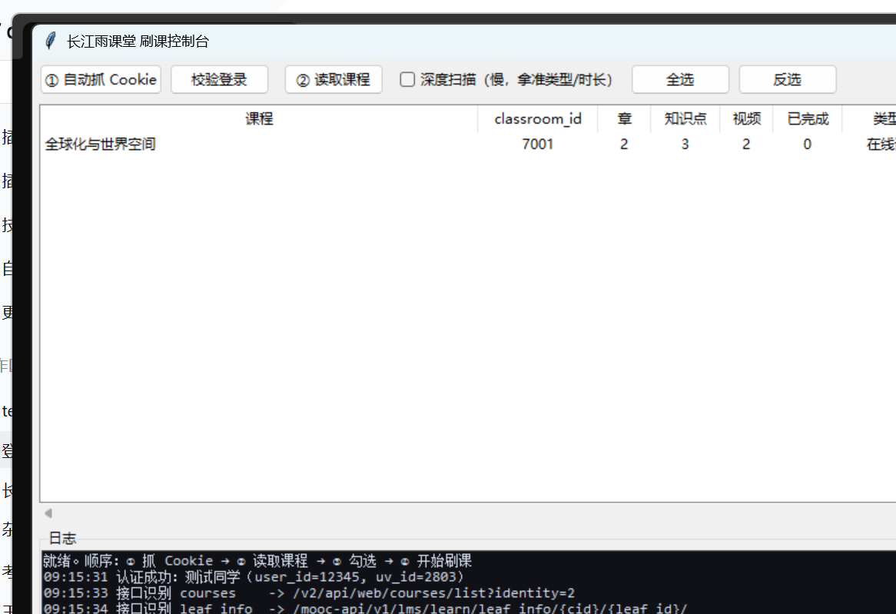

<div align="center">

<h1>雨课堂刷课助手</h1>

<p><b>长江雨课堂 · 接口自动识别 · 自动补课 · 图形界面</b></p>

<p>
  <a href="https://www.python.org/"></a>
  
  
  <a href="#-免责声明"></a>
</p>

<p>
  <a href="#-功能">功能</a> ·
  <a href="#-快速开始">快速开始</a> ·
  <a href="#-图形界面三步">图形界面</a> ·
  <a href="#-命令行">命令行</a> ·
  <a href="#-工作原理">原理</a> ·
  <a href="#-常见问题">常见问题</a>
</p>

</div>



> [!WARNING]
> 本项目仅供**个人学习与技术交流**，请勿用于代刷、售卖等商业用途。
> 使用脚本产生的任何后果（包括但不限于成绩、考勤、账号处罚）由使用者自行承担。
> 请优先完成学校要求的正常学习任务 —— 刷课不能代替学习。

---

## ✨ 功能

- **接口自动识别**：只需要一个 cookie。认证、课程列表、章节树、知识点详情、进度、心跳接口全部自动探测，结果缓存到 `profile.json`，下次直接复用；接口小改版也不用改代码。
- **三种课型通吃**：
  - 普通 MOOC 课程（有章节、有视频 leaf）；
  - 章节为空、但学习日志里有课件记录的「活动兜底」课程；
  - 2025 年改版后的「学习空间 / lms-graph」知识图谱课程。
- **Cookie 自动捕捉**：先尝试直接读本地 Chromium Cookie 库（DPAPI + AES-GCM）；读不到就拉起一个调试端口的 Edge/Chrome，你登录一次，脚本通过 CDP 让浏览器自己交出 cookie。登录态过期会自动重抓。
- **批量心跳 + 服务端确认**：按官方播放器字段批量上报（默认 20 秒/条、50 条/批），每批发完轮询进度接口，以服务端的 `rate` / `completed` 为准，不靠本地自算。已完成的视频自动跳过，可重复运行。
- **视频时长四路兜底**：`leaf_info` → 进度接口 → 直接解析 mp4 的 `moov/mvhd` → 同章估算。没看过的视频也能拿到真实时长，不会因为 `duration=0` 卡住。
- **图形界面**：tkinter 实现，零第三方依赖。勾选课程、实时进度、分级日志、快捷键、参数记忆，还能一键打包成 exe。
- **性能**：长连接 keep-alive、5 路并发扫描、15 分钟扫描缓存。实测 79 门课从几分钟降到十几秒（视网络而定）。
- **自动自愈**：扫描或刷课中途遇到 401，自动重抓 cookie 并重试当前课程，其余任务继续。
- **一键打包**：`build.py` 调 PyInstaller 生成目录版 + zip 发布包，目标机器不需要装 Python。

## 🚀 快速开始

### 环境要求

| 项 | 要求 |
|---|---|
| 系统 | Windows 10 / 11 |
| Python | 3.9 及以上（源码运行） |
| 第三方依赖 | **无**，全部使用标准库 |
| Node.js | 可选，仅 `capture.py --mode db` 解密 Chromium v10 cookie 时需要；CDP 模式不需要 |

### 方式一：源码运行（推荐）

```powershell
git clone https://github.com/yourname/yuketang-bot.git
cd yuketang-bot
python gui.py
```

也可以直接双击 `启动.bat` 或 `run_gui.bat`：它们会自动寻找 Python，并优先用 `pythonw.exe` 启动，不留黑框。

首次运行不需要 `config.json`，打开界面点「① 自动抓 Cookie」即可。

### 方式二：打包成 exe

打包需要额外安装 PyInstaller（只在打包机上装，目标机器不需要）：

```powershell
pip install pyinstaller
python build.py --zip
```

`pillow` 是可选的（只用于把 png 转成 ico；仓库里已有 `assets/app.ico`，不装也能打包）。

产物：

```
dist\雨课堂刷课助手\
├─ 雨课堂刷课助手.exe    ← 双击运行
├─ _internal\            ← 运行时依赖，别删
└─ 使用说明.txt
dist\雨课堂刷课助手-v1.0-win64.zip
```

把 zip 发给没有 Python 的同学，解压双击就能用。配置、cookie、日志都写在 exe 同目录，整个文件夹可以直接拷走。

> 也可以从 [Releases](../../releases) 下载已打包版本（如果仓库上传了的话）。

## 🖥 图形界面：三步

| 步骤 | 操作 | 说明 |
|---|---|---|
| ① | 点 **自动抓 Cookie** | 先读本地浏览器库，失败就拉起浏览器让你登录一次；抓到后自动校验并写入配置 |
| ② | 点 **读取课程** | 后台识别接口、拉课程列表，并逐门扫描章节 / 知识点 / 已完成 / 总时长，表格实时回填 |
| ③ | 勾选课程 → **开始刷课** | 后台逐门跑心跳，进度条按知识点推进，随时可以「停止」 |

表格列：`课程 / classroom_id / 章 / 知识点 / 视频 / 已完成 / 类型 / 总时长 / 状态`。

- **类型**：`在线课`（普通章节）、`学习空间`（lms-graph 课）、`活动兜底`（用学习日志构造）、`课堂型`（直播/实习，无视频可刷）。
- **状态**：`可刷`（有未完成视频）、`已完成`、`无内容`、`错误`。
- **双击**某行 = 在浏览器打开课程页；**右键** = 只刷这门课 / 复制 `classroom_id`。

快捷键：

| 按键 | 功能 |
|---|---|
| `F5` | 读取课程 |
| `F9` | 开始刷课 |
| `Esc` | 停止 |
| `Ctrl+A` | 全选 |
| `Ctrl+L` | 清空日志 |

参数区：心跳秒（默认 20）、批大小（默认 50）、每课上限（0 = 不限）、真速推进、含课件幻灯片。参数和窗口位置会被记住。

## 💻 命令行

```powershell
python main.py --list                        # 只识别 + 列课程
python main.py --plan                        # 打印课程树/类型/时长/进度，不上报任何数据
python main.py --auto                        # 全自动：所有课程、只跑未完成的视频
python main.py --course 高等数学 --auto       # 只跑名称匹配的课
python main.py --index 2 --auto              # 按 --list 的编号选课
python main.py --auto --with-slide           # 连课件幻灯片一起跑
python main.py --auto --realtime             # 按墙钟真速推进（更稳，更慢）
python main.py --auto --redetect --dump      # 接口改版后重新识别，并保存原始响应
```

Windows 下也可以用启动器，参数完全一致：

```powershell
.\run.bat --auto
.\run.ps1 --auto
```

常用参数：

| 参数 | 默认 | 说明 |
|---|---|---|
| `--list` | — | 只识别并列出课程 |
| `--plan` | — | 打印课程树、类型、时长、进度，不上报 |
| `--auto` | — | 自动跑所有课程的未完成视频 |
| `--course <关键词>` | — | 按课程名筛选 |
| `--index <n>` | — | 按 `--list` 编号选课 |
| `--step <秒>` | `20` | 每条心跳覆盖的秒数（官方约 1 秒，补课用 20） |
| `--batch <n>` | `50` | 单批心跳条数上限（官方 localStorage 上限 50） |
| `--realtime` | 关 | 按墙钟节奏推进，时间戳更自然 |
| `--with-slide` | 关 | 同时上报课件（幻灯片） |
| `--limit <n>` | `0` | 每门课最多处理多少个知识点，0 = 不限 |
| `--redetect` | 关 | 忽略 `profile.json`，重新识别接口 |
| `--dump` | 关 | 把识别到的原始响应写到 `dump/` |
| `--relogin` | 关 | 强制重新抓 cookie |
| `--no-capture` | 关 | cookie 缺失/失效时不自动开浏览器 |
| `--host <url>` | `https://changjiang.yuketang.cn` | 覆盖站点地址 |
| `--no-graph-fallback` | 默认启用 | 加上则关闭「学习空间」兜底 |
| `--no-activities-fallback` | 默认启用 | 加上则关闭「活动日志」兜底 |

退出码：`0` 正常、`2` 缺 cookie、`3` 登录态失效、`4` 接口识别失败、`5` 没选课、`6` 部分知识点失败（重跑通常能补齐）。

## 🍪 Cookie 怎么来

`main.py` 在缺 cookie 或登录态失效时会**自动触发捕捉**，所以大多数情况下直接 `python main.py --auto` 就行。

| 方式 | 命令 | 适用场景 |
|---|---|---|
| 自动（推荐） | `python capture.py` | 默认。本地库读不到时自动转 CDP |
| 只走 CDP | `python capture.py --mode cdp` | 本地库被占用 / Edge 127+ App-Bound 加密 |
| 只走本地库 | `python capture.py --mode db` | 浏览器已关闭、且是 v10 格式（需要 Node.js） |
| 手工 | 见下方 | 以上都失败，或只想用一次性 cookie |

```powershell
python capture.py --check                          # 只校验 cookie.txt 是否还有效
python capture.py --mode cdp --browser Edge --wait 600   # 多等一会儿登录
```

### 手工获取（备用）

1. 浏览器打开 <https://changjiang.yuketang.cn> 并登录。
2. `F12` → **Network** → 刷新页面 → 点任意 XHR 请求。
3. 在 **Request Headers** 里复制整行 `Cookie:`。
4. 任选一种给法：

```powershell
# ① 直接写在命令行
python main.py --auto --cookies "csrftoken=xxx; sessionid=yyy; university_id=2803"

# ② 存成 cookie.txt，用 @ 引用（PowerShell 里 @ 参数要加引号）
python main.py --auto --cookies "@cookie.txt"

# ③ 粘进 config.json 的 cookie_string，之后命令里不用再带
python main.py --auto
```

> `csrftoken` / `sessionid` / `university_id` 会从 cookie 串自动拆出来，`uv_id` 也会从
> `/v2/api/web/userinfo` 自动识别，不用手填。

## ⚙️ 配置文件

仓库只提供脱敏的 `config.example.json`。首次使用时复制一份：

```powershell
Copy-Item config.example.json config.json
```

也可以不建，程序会自动生成 / 自动写入 cookie。

| 字段 | 默认 | 说明 |
|---|---|---|
| `cookie_string` | `""` | 完整 cookie 串，抓取后自动写入 |
| `step` | `20` | 每条心跳覆盖秒数 |
| `batch` | `50` | 单批心跳上限 |
| `realtime` | `false` | 是否按墙钟真速推进 |
| `gap` | `"0.2,0.6"` | 知识点之间的随机休息区间（秒） |
| `with_slide` | `false` | 是否同时跑课件幻灯片 |
| `workers` | `5` | 课程扫描并发数，被风控时调到 2~3 |
| `cache_ttl` | `900` | 扫描缓存秒数，0 = 关闭 |
| `limit` | `0` | 每课最多处理知识点数，0 = 不限 |
| `deep_scan` | `true` | GUI「深度扫描」开关，扫描全部课程 |
| `geometry` | — | 上次窗口位置（程序自动记录） |

> `config.json`、`cookie.txt`、`profile.json`、`scan_cache.json`、`dump/`、`dist/` 都已在 `.gitignore` 中，**不要提交** —— 它们包含你的登录态和学习数据。

## 🔧 工作原理

整条链路都是普通 HTTP 请求，不注入网页、不修改官方前端：

1. **认证**：`GET /v2/api/web/userinfo` 拿到 `user_id` / `uv_id`，验证 cookie。
2. **课程列表**：`GET /v2/api/web/courses/list?identity=2`，枚举 `classroom_id`。
3. **课程树**：`GET /mooc-api/v1/lms/learn/course/chapter?cid=...&sign=...`，拿章节和 leaf。
   `sign` 来自 `GET /v2/api/web/classrooms/{cid}?role=5`。
4. **类型判定**：不写死 `leaf_type`。`media.duration > 0` 判为视频，`cards/slides/pages` 非空判为课件，其余跳过。
5. **心跳**：按官方播放器字段构造 `POST /video-log/heartbeat/`（`lob`、`n`、`c`、`v`、`skuid`、`cc` 等），批量上报。
6. **确认**：每批后查 `/video-log/get_video_watch_progress/`，服务端 `rate` 前进或 `completed=1` 才算完成。

三种课型的处理：

| 课型 | 表现 | 内容来源 | 支持 |
|---|---|---|---|
| MOOC 在线课 | 有章节、有视频 leaf | 章节接口 | ✅ 正常刷 |
| 学习空间（lms-graph） | 章节为空，课程跳到 `/ai-workspace/lms-graph/...` | 知识图谱节点 → 视频 | ✅ 按图谱刷 |
| 课堂型（直播/实习） | 章节和图谱都没有视频 | 课堂活动/回放 | ❌ 自动跳过 |

针对时长拿不到、登录态失效、0 章课程等细节，见 [docs/DESIGN.md](docs/DESIGN.md)。

### 使用建议（降低风控风险）

- 单账号串行跑，不要多开，也不要同一 cookie 并发。
- 每天刷几门就够，别挂 24 小时；跑完就停。
- 想更自然就加 `--realtime`，或在 `config.json` 里把 `step` 调小。
- 考试、限时测验、直播签到期间不要跑上报。
- 多个账号请一账号一 IP，别在同一出口连续登录。

## 📁 目录结构

```
yuketang-bot/
├─ gui.py              # 图形界面（tkinter，零依赖）
├─ main.py             # 命令行入口
├─ ykt.py              # 协议层：认证 / 接口识别 / 课程树 / 进度 / 心跳
├─ player.py           # 调度层：批量心跳、进度确认、课程扫描
├─ graphspace.py       # 学习空间（lms-graph）课型
├─ videometa.py        # 纯标准库解析 mp4 时长
├─ capture.py          # Cookie 自动捕捉（本地库 / CDP）
├─ paths.py            # 源码 / exe 路径适配
├─ build.py            # PyInstaller 一键打包
├─ probe.py            # 单课程接口诊断
├─ sniff.py            # 真号抓包（调试用）
├─ tools/aesgcm.js     # Chromium v10 cookie 解密（Node，无第三方依赖）
├─ config.example.json # 脱敏配置模板
├─ docs/
│  ├─ DESIGN.md        # 技术设计与排错笔记
│  └─ gui.png          # 界面截图
└─ tests/              # mock 服务 + 捕捉/GUI 自测
```

`dump/`、`dist/`、`build/`、`profile.json` 等都是运行产物，已被忽略。

## 🧪 开发与测试

测试全部跑在本地 mock 上，不会接触真实账号：

```powershell
# 终端 1：启动 mock 服务
python tests/mock_server.py 8901

# 终端 2：只读验证
python main.py --host http://127.0.0.1:8901 --cookies "csrftoken=x; sessionid=y; university_id=2803" --list
python main.py --host http://127.0.0.1:8901 --cookies "csrftoken=x; sessionid=y; university_id=2803" --plan

# 自测脚本
python tests/test_capture.py       # cookie 解密 / CDP
python tests/test_heal.py          # 401 自愈
python tests/test_gui_smoke.py     # GUI 冒烟（需要桌面会话）
```

真号只读自检（不发心跳、不写进度，结果写到 `dump/selftest.txt`）：

```powershell
python gui.py --selftest
```

`probe.py` 用于诊断单门课到底该走哪个接口：

```powershell
python probe.py --course 示例课程
python probe.py --index 3
python probe.py --classroom-id <classroom_id>
python probe.py --classroom-id <classroom_id> --graph   # 学习空间课
```

## ❓ 常见问题

<details>
<summary>提示「缺 cookie」或 401 怎么办？</summary>

先跑 `python capture.py --check` 看 cookie 是否还有效。失效就重新抓：

```powershell
python capture.py
python main.py --auto --relogin
```

程序内置自愈：扫描/刷课遇到 401 会自动重抓并重试当前课程。自动抓取依赖浏览器里的登录态 —— 如果 Edge/Chrome 正开着且专用配置里没登录过，可能需要关掉浏览器再抓一次。
</details>

<details>
<summary>课程显示「0 章 / 0 个知识点」？</summary>

先看类型列：

- `学习空间`：正常，内容在知识图谱里，可以直接刷；
- `课堂型`：直播/实习课，没有可刷视频，跳过即可；
- `?`：用 `python probe.py --course <课程名>` 诊断接口，把 `dump/probe/` 里的原始响应拿来对照。
</details>

<details>
<summary>浏览器起来了，但提示「调试端口没开」？</summary>

通常是上一次抓取启动的浏览器没退干净，还占着专用 profile。程序会自动清理残留进程并重试；仍失败就：

```powershell
python capture.py --mode cdp --fresh-profile
```

或者关掉所有 Edge 窗口后重试。
</details>

<details>
<summary>视频「拿不到时长」被跳过？</summary>

新版已按四路兜底取时长（`leaf_info` → 进度接口 → mp4 头 → 同章估算）。如果仍然拿不到，用 `python gui.py --selftest` 看具体是哪一步失败，再把 `dump/selftest.txt` 发出来。
</details>

<details>
<summary>exe 被杀毒软件拦截 / 单文件版起不来？</summary>

PyInstaller 打包的程序常被误报。优先用目录版（`python build.py`），不要用 `--onefile`；目录版不写 TEMP，启动也更快。介意的话直接从源码运行。
</details>

<details>
<summary>刷课会不会被检测？</summary>

脚本尽量模拟官方播放器的心跳字段，但**无法保证绝对安全**。请控制频率、不要多开、不要在考试期间使用。因使用本工具导致的任何账号或成绩问题，作者不承担责任。
</details>

## ⚠️ 免责声明

- 本项目仅供**个人学习、技术研究与交流**，不得用于代刷、售卖、牟利或其他商业用途。
- 本项目不绕过任何付费/权限限制，只对**账号本身已有权限**的课程上报学习进度。
- 使用本项目即表示你已了解相关风险，并自愿承担全部后果（包括但不限于账号被封禁、成绩/考勤异常、违反学校规定等）。
- 请尊重教师与平台的劳动成果，认真完成课程学习；脚本不能替代真正的学习。
- 如有侵权，请联系作者删除，作者将立即停止相关内容的维护。

## 🙏 致谢

- 初代油猴脚本与接口思路参考：[Niuwh/yuketang-jiaoben](https://github.com/Niuwh/yuketang-jiaoben)。
- 接口字段对齐参考了雨课堂官方前端包体（仅用于分析请求格式，未分发官方代码）。
- 感谢所有提交 issue、帮忙抓包校准字段的同学。

## 📄 许可

本项目未附带开源许可证，默认保留所有权利。如需引用代码，请先联系作者并注明出处。
