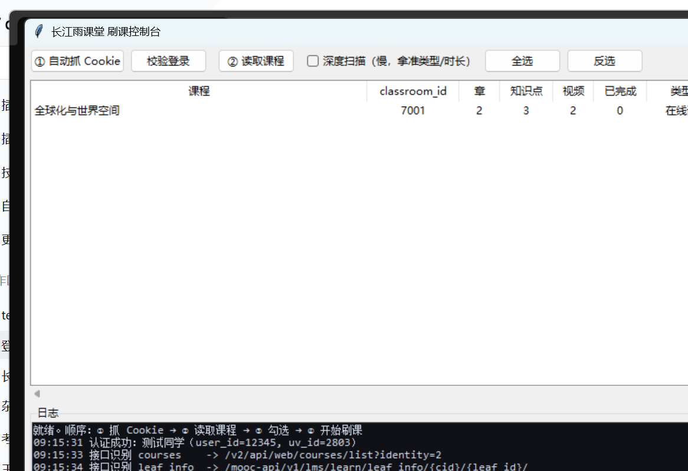

# 技术设计与排错笔记

> 这是开发过程的详细记录（接口探测、踩坑、实测数据），面向想改代码 / 排查问题的读者。
> 日常使用看 [README](../README.md) 就够了。

纯标准库，Python 3.9+ 直接跑。核心是**自动识别**：只喂一个 cookie，接口路径、uv_id、课程树、
leaf 类型（video/slide/other）、视频时长、课件页数、进度接口、心跳接口全部自己探出来，
结果落 `profile.json`，下次直接复用。

```
yuketang-bot/
├─ ykt.py               协议层：认证探针 / 接口识别 / 课程树 / 进度 / 心跳字段
├─ player.py            调度层：批量心跳 + 轮询完成 / 课件逐页 / 课程扫描
├─ gui.py               可视化控制台：读课程 → 勾选 → 刷课（tkinter，零依赖）
├─ paths.py             运行环境适配：源码 / 打包 exe 的路径与 stdio
├─ build.py             一键打包：PyInstaller → dist/雨课堂刷课助手 + zip
├─ main.py              CLI：--list / --plan / --auto / --auto-cookie / --redetect
├─ capture.py           cookie 自动捕捉：本地库(DPAPI+AES-GCM) / CDP / 校验 / 落盘
├─ tools/aesgcm.js      node 解 Chromium v10 cookie（无第三方依赖）
├─ probe.py             课程树诊断：某门课到底该用哪个接口拉章节
├─ sniff.py             真号抓包：让官方页面自己发请求，记录 method/url/body
├─ config.json          cookie + 节奏参数
├─ profile.json         自动识别的产物（首次运行生成）
├─ run.bat / run.ps1    cmd / PowerShell 启动器（自动找解释器）
├─ run_gui.bat          可视化控制台启动器
├─ docs/gui.png         控制台截图
├─ dist/                打包产物：雨课堂刷课助手.exe + zip 发布包
├─ dump/                原始响应、官方包体、逆向参考
└─ tests/               mock 服务 + capture 自测 + GUI 冒烟测试
```

> 树里的 `config.json`、`profile.json`、`dist/`、`dump/` 是本地运行 / 调试产物，
> 已在 `.gitignore` 中，仓库里不包含。

---

## 0. 傻瓜式使用（打包版，推荐给非开发者）

> 发布包不随仓库提供：本地跑 `python build.py --zip` 生成，或从 Releases 下载。

```powershell
# 解压发布包，双击 exe 即可，不需要装 Python
dist\雨课堂刷课助手-v1.0-win64.zip
  └─ 雨课堂刷课助手\
       ├─ 雨课堂刷课助手.exe   ← 双击这个
       ├─ _internal\           ← 运行时依赖，别删
       └─ 使用说明.txt
```



三步走：

1. 双击 `雨课堂刷课助手.exe`
2. 点 **① 自动抓 Cookie** → 弹出的浏览器里登录雨课堂（一次就够，之后会自动续期）
3. 点 **② 读取课程** → 表格里勾选课程 → 点 **③ 开始刷课**

配置、cookie、日志都写在 exe 同目录，整个文件夹可以直接拷给别人用（U 盘带走也行）。

### v2 界面改了什么

| 项 | v1 | v2 |
|---|---|---|
| 观感 | 原生 ttk 灰框 | 蓝色品牌头 + 卡片式布局 + 状态色（可刷=绿 / 已完成=灰 / 错误=红） |
| 登录态 | 只有日志里能看到 | 右上角常驻徽标：`已登录：xxx` / `未登录` |
| 表格 | 列会被挤压、没有状态列 | 9 列固定宽度 + 横向滚动 + 状态列，双击行打开课程页，右键菜单（只刷这门课 / 复制 ID） |
| 日志 | 单色 | 分级着色（INFO/WARN/ERROR/OK）+ 自动滚动开关 + 保存/清空 |
| 快捷键 | 无 | F5 读取、F9 开刷、Esc 停止、Ctrl+A 全选、Ctrl+L 清日志 |
| 参数 | 每次重填 | 记住上次的心跳秒/批大小/上限/开关 + 窗口位置 |
| 高 DPI | 文字虚、布局错位 | 固定 tk scaling + 像素字号，125%/150% 缩放下布局一致 |
| 打包 | 只能源码跑 | PyInstaller 目录版，双击即用，不依赖本机 Python |

### 自己重新打包

```powershell
python build.py            # 目录版（默认，最稳）
python build.py --zip      # 目录版 + zip 发布包
python build.py --onefile  # 单文件版（启动要解压到 TEMP，个别杀软会拦）
```

> 单文件版在你这台机器上被 TEMP 限制挡住了（`Could not create temporary directory`），
> 所以发布包默认用目录版：启动快、不写 TEMP、被杀软拦的概率低。


界面上就是一条流水线，四个按钮对应四步：

| 按钮 | 做什么 |
|---|---|
| ① 自动抓 Cookie | 本地库 → 失败就拉起调试端口的 Edge，你登录一次，脚本自己拿走 cookie 并校验 |
| ② 读取课程 | 后台线程识别接口 + 拉课程列表 + 逐门扫章节/知识点/已完成/总时长，表格实时回填 |
| 勾选课程 | Ctrl/Shift 多选，或「全选」「反选」；双击某行等于直接开始刷 |
| ③ 开始刷课 | 后台逐个课程跑心跳，进度条按知识点推进，「停止」随时可中断 |

表格列：`课程 / classroom_id / 章 / 知识点 / 视频 / 已完成 / 类型 / 总时长 / 状态`。
类型列会标出 `在线课`（有 leaf，能刷）、`课堂型`（无 leaf，自动跳过）、`活动兜底`（用活动日志构造）。

参数区：心跳秒（默认 20）、批大小（默认 50）、每课上限、真速推进（默认开）、含课件幻灯片。
日志区实时滚动（黑底），所有 HTTP 识别与心跳过程都能看到。

自动化等价命令（CI / 无桌面时用）：

```powershell
python gui.py --autoload        # 启动即自动读取课程
python main.py --auto           # 纯命令行全自动
```

**为什么用 tkinter**：Python 自带，零 pip 依赖，`run_gui.bat` 直接 `pythonw.exe` 拉起不残留控制台窗口。

---

## 0. 怎么运行（Windows，三步）

### ⚠ 先看：PowerShell 和 cmd 的三处语法差异

在 **PowerShell** 里（Windows 11 默认终端就是它）：

```powershell
cd D:\code\yuketang-bot          # 不要写 cd /d，/d 是 cmd 语法，PS 会报 Set-Location 参数错误
.\run.bat --help                 # 当前目录的脚本必须加 .\ ，否则报"无法将 run.bat 项识别为..."
.\run.ps1 --help                 # 原生 PS 启动器（两者等价）
.\run.bat --auto --cookies "@cookie.txt"   # @ 开头的参数必须加引号，否则 PS 会当 splatting 报 ParserError
```

在 **cmd** 里：

```bat
cd /d D:\code\yuketang-bot
run.bat --help
run.bat --auto --cookies @cookie.txt
```

`run.ps1` 被 ExecutionPolicy 拦住时，用这个跑（不改系统策略）：

```powershell
powershell -NoProfile -ExecutionPolicy Bypass -File .\run.ps1 --auto
```

### 步骤 1：确认能跑

```powershell
cd D:\code\yuketang-bot
.\run.bat --help
```

能打出 `usage: main.py ...` 就说明环境 OK。两个启动器都会按顺序找解释器：
`%YKT_PYTHON%` → DSH 自带运行时 → `py -3` → `python`，全都找不到会给出提示。

> 本机 PATH 里的 `python.exe` 是微软商店占位符，装了 Python 之前执行只会跳应用商店，
> 所以启动器优先用 DSH 自带运行时（实测可用）。也可以用系统装的真 Python 3.9+。

### 步骤 2：Cookie —— 现在能自动抓了

**一条命令，全自动**（推荐）：

```powershell
.\run.bat --auto-cookie          # 抓完 cookie 直接继续跑；也可以 python capture.py
```

它会：本地浏览器库（能读就秒抓）→ 读不到就拉起一个调试端口的 Edge/Chrome 窗口 →
你在窗口里登录雨课堂 → 脚本自己从 CDP `Storage.getCookies` 拿 cookie → 校验
`/v2/api/web/userinfo` → 写 `cookie.txt` + `config.json` → 继续执行。

`main.py` 已经内置这个兜底：**没有 cookie 或 sessionid 过期时会自动触发捕捉**，
所以你直接 `.\run.bat --auto` 也行；不想让它开浏览器就加 `--no-capture`。

三条路线的取舍：

| 方式 | 命令 | 什么时候用 | 备注 |
|---|---|---|---|
| 自动（推荐） | `.\run.bat --auto-cookie` | 默认 | 本地库 → CDP，全程不用手抄 |
| 只走 CDP | `python capture.py --mode cdp` | 本地库读不了（Edge 127+ App-Bound / 库被占用） | 浏览器自己解密，v10/v20 都行 |
| 只走本地库 | `python capture.py --mode db` | Edge/Chrome 已关闭、且是 v10 格式 | 需要 node（解 AES-GCM）和 PowerShell（DPAPI），本机都有 |
| 手工 | F12 复制 Cookie | 上面都失败，或只想要一次性 | 最麻烦但最万能 |

```powershell
python capture.py               # auto
python capture.py --check       # 只校验 cookie.txt 还有效没
python capture.py --mode cdp --browser Edge --wait 600   # 多等一会儿登录
```

几个实话：

- **Edge 正在运行时它的 cookie 库是独占锁的**，`--mode db` 会明确提示"库被浏览器独占"，
  这时 `--mode cdp` 不用关浏览器就能抓。
- Edge/Chrome 127+ 用 **App-Bound 加密（v20）**，DPAPI 主密钥解不开；cdp 路线不受影响。
- cdp 默认用**独立配置** `%LOCALAPPDATA%\ykt-capture-profile`，需要在新窗口登录一次；
  之后这个配置会记住登录态，再抓就是几秒钟。Edge 没在运行时脚本会用你现有配置启动，
  通常已登录，直接秒抓。
- 抓到的 cookie 有有效期，过期后 `--auto` 会自动再抓一次。

<details>
<summary>手工取 Cookie（备用）</summary>

1. 浏览器打开 <https://changjiang.yuketang.cn>，账号密码登录，进到课程页。
2. `F12` → **Network** 标签 → 刷新页面 → 点任意一条 XHR 请求（如 `courses/list`）。
3. 在 **Request Headers** 里找到 `Cookie:` 整行，全选复制（形如
   `csrftoken=xxx; sessionid=yyy; university_id=2803; ...`）。
4. 三种给法，任选一种：

```powershell
# ① 直接写在命令行
.\run.bat --auto --cookies "csrftoken=xxx; sessionid=yyy; university_id=2803"

# ② 存成 cookie.txt（这个目录下），用 @ 引用（PS 里记得加引号）
Set-Content cookie.txt 'csrftoken=xxx; sessionid=yyy; university_id=2803'
.\run.bat --auto --cookies "@cookie.txt"

# ③ 粘进 config.json 的 cookie_string 字段，以后命令里不用再带
.\run.bat --auto
```

`csrftoken` / `sessionid` / `university_id` 会从 cookie 串里自动拆出来，`uv_id` 也能从
`/v2/api/web/userinfo` 自动识别，不用手填。

</details>

### 步骤 3：跑

```powershell
.\run.bat --list                       # 只识别 + 列课，先确认能登进去
.\run.bat --plan                       # 打印课程树/类型/时长/进度，不上报任何数据
.\run.bat --auto                       # 全自动补课（所有课程、只跑未完成的视频）
```

只跑一门：

```powershell
.\run.bat --index 1                            # 按 --list 的编号
.\run.bat --course 全球化                        # 按课程名关键词
.\run.bat --course 全球化 --with-slide          # 连课件幻灯片一起
.\run.bat --auto --realtime --step 20          # 按墙钟真速推进（更稳更慢）
.\run.bat --auto --redetect --dump             # 接口改版后重新识别并落原始响应
```

不想用启动器，直接调 Python 也行（把解释器换成你自己装的）：

```powershell
python main.py --auto --cookies "@cookie.txt"     # 用 PATH 里的解释器
```

### 退出码

| 码 | 含义 | 处理 |
|---|---|---|
| 0 | 正常结束 | — |
| 2 | 缺 cookie | 按步骤 2 重新取 |
| 3 | 登录态失效 | `sessionid` 过期，重新取 cookie |
| 4 | 接口识别失败 | `.\run.bat --auto --redetect --dump`，看 `dump/` 里的原始响应 |
| 5 | 没选课 | 加 `--course` / `--index` / `--auto` |
| 6 | 部分知识点失败 | 直接重跑，通常能补齐 |

### 401 / 登录态失效怎么办（已内置自愈）

雨课堂的 `sessionid` 会因为你**在别处重新登录、或者浏览器里换了账号**而被踢掉，表现就是
扫描或刷课中途 `AuthError: 401 ...`。现在的处理是自动的：

- 扫描某门课返回 401 → 自动重抓 cookie → 换 client → **重试同一门课**，其余课程继续扫；
- 刷课中途 401 → 自动重抓 → 重试当前课程；
- 命令行同理：`--auto` 撞到 401 会自己抓一次，抓不到才以退出码 3 结束。

手动兜底：

```powershell
python capture.py --check          # 先看 cookie 还有效没
python main.py --auto --relogin    # 强制重新抓 cookie 再跑
```

⚠ 自动自愈能不能抓到「新」cookie，取决于浏览器登录态在不在：

| 情况 | 结果 |
|---|---|
| 你在 Edge/Chrome 里还是登录状态，且浏览器**已关闭** | 直接用你的真实配置秒抓，最省事 |
| 浏览器**正在运行** | 只能用独立配置 `%LOCALAPPDATA%\ykt-capture-profile`，如果没在里面登录过就会等超时 |
| 想一劳永逸 | 关掉浏览器跑一次 `python capture.py`，之后这个配置会记住登录态，自愈就是几秒钟的事 |

判定依据是 `/v2/api/web/userinfo` 是否 `errmsg=Success`，抓到的 cookie 会写回 `cookie.txt` 和
`config.json.cookie_string`。

### 「浏览器起来了但调试端口没开」怎么办（已修掉主因）

这个报错的真因不是"被策略禁用"，而是**残留实例占着 profile**：

- 上一次抓取启动的 Edge 没退干净，还占着 `%LOCALAPPDATA%\ykt-capture-profile`；
- 这次再启动，新进程发现 profile 已被占用 → 把 URL 交给**已有实例** → 自己立刻退出 →
  `--remote-debugging-port` 根本没生效 → 端口永远不开。反复重试会一直失败。

现在的处理：

1. 启动前用 `Win32_Process` 查命令行里带该 profile 的浏览器进程，**先 taskkill 清理**；
2. 成功后把端口记到 `.ykt-cdp-port`，下次直接复用，不反复拉起；
3. 独立配置仍失败就自动换**全新临时 profile** 再试一次；
4. 浏览器 stdout/stderr 重定向到 `dump/edge-launch.log`（pythonw 下没有有效句柄会让 Chromium 起不来）；
5. 全失败时的报错带诊断：profile、锁文件、浏览器日志尾部、手工命令。

手工兜底：

```powershell
python capture.py --mode cdp --fresh-profile   # 用全新临时 profile，绕开被占用的
# 或手动开一个调试实例，再让脚本复用
& "C:\Program Files (x86)\Microsoft\Edge\Application\msedge.exe" --remote-debugging-port=9222 --user-data-dir="$env:TEMP\ykt-dbg"
python capture.py --mode cdp
```

实测（先故意起一个不带调试端口、占着独立 profile 的 Edge）：

```
INFO 清理占用 profile 的残留浏览器进程：[15060, 5928, 9132, ...]
INFO 启动浏览器：msedge.exe（profile=...\ykt-capture-profile port=9222）
INFO 调试端口已就绪：127.0.0.1:9222（独立配置）
INFO 当前命中域名 cookie：['csrftoken', 'django_language', 'sessionid']
RESULT jar={'sessionid': 'azzxup21...', ...} elapsed=7.1s
```


---

## 0.1 命令速查（Linux / macOS / 直接用 python 时）

```bash
python main.py --list  --cookies "..."                 # 只识别 + 列课程
python main.py --plan  --cookies "..."                 # 打印课程树/类型/时长/进度，不上报
python main.py --auto  --cookies "..." --realtime      # 按墙钟真速（更稳，更慢）
python main.py --course 全球化 --cookies "..."          # 只跑匹配的课
python main.py --auto  --cookies "..." --redetect      # 接口改版后强制重新识别
python main.py --auto  --cookies "..." --with-slide    # 连课件(幻灯片)一起跑
```

cookie 也可以写在 `config.json` 的 `cookie_string`，之后命令里就不用再带 `--cookies`。

## 1. 自动识别做了什么

| 步骤 | 动作 | 产物字段 |
|---|---|---|
| 1 | `GET /v2/api/web/userinfo` 认证探针，拿 `user_id` / `name` / `university_id` | `user_id` `user_name` `uv_id` |
| 2 | 课程列表多候选探测，取第一个返回非空 list 的 | `endpoints.courses` |
| 3 | `GET /mooc-api/v1/lms/learn/course/chapter?cid=` 拉课程树，兼容 `section_leaf_list`/`leaf_list` 两种挂载 | `endpoints.chapters` |
| 4 | 每个 leaf 拉 `leaf_info`，**不写死 leaf_type**：`content_info.media.duration>0` → video，`cards/slides/pages` 非空 → slide，其余 → other | `leaf_kinds` |
| 5 | 进度接口探测：`/video-log/get_video_watch_progress/` 是否回 `rate/completed` | `endpoints.progress` |
| 6 | 活动日志 `logs/learn/{cid}` 建 `leaf_id → courseware_id` 映射（心跳 `cc` 字段） | 运行时 |
| 7 | 心跳接口 `POST /video-log/heartbeat/` 首次上报后落缓存 | `endpoints.heartbeat` |

识别结果长这样（`profile.json`）：

```json
{
  "host": "https://changjiang.yuketang.cn",
  "uv_id": "2803",
  "user_id": 12345,
  "user_name": "张三",
  "endpoints": {
    "userinfo": "/v2/api/web/userinfo",
    "courses": "/v2/api/web/courses/list?identity=2",
    "chapters": "/mooc-api/v1/lms/learn/course/chapter?cid={cid}",
    "leaf_info": "/mooc-api/v1/lms/learn/leaf_info/{cid}/{leaf_id}/",
    "progress": "/video-log/get_video_watch_progress/",
    "activities": "/v2/api/web/logs/learn/{cid}?actype=-1&page=0&offset=100&sort=-1",
    "heartbeat": "/video-log/heartbeat/"
  },
  "leaf_kinds": { "0": "video", "1": "slide" }
}
```

`--plan` 输出（本地 mock 实测）：

```
《全球化与世界空间》 classroom_id=7001  2 章 / 3 个知识点
章节              小节          leaf_type  类型   时长s  页数  完成  名称
第一章 导论        1.1 概念            0  video    120     0    0%  1.1.1 视频：什么是全球化
第一章 导论        1.1 概念            1  slide      0     6     -  1.1.2 课件：全球化简史
第二章             2.1 演进            0  video    120     0    0%  2.1.1 视频：三次浪潮
```

leaf_type 0/1 是这所学校的情况，其它学校/课程编号可能不同 —— 所以类型是从内容判的，不是从常量判的。

## 1.5 有些课显示「0 章 / 0 个知识点」是怎么回事

雨课堂升级后账号里混着三种课：

| 课型 | 表现 | 内容在哪 | 能不能刷 |
|---|---|---|---|
| MOOC 型（在线课程） | 有章节、有视频 leaf，如《设计的力量》11 章 52 个知识点 | `/mooc-api/v1/lms/learn/course/chapter?cid=` | 能，正常跑 |
| 学习空间型（ai-workspace / lms-graph） | 章节接口返回空，点课程会跳到 `/ai-workspace/lms-graph/{cid}/video/{vid}?node_id=` | 知识图谱：课程 → graph_id → node → video | 能，见下面 1.6 |
| 课堂型（直播/实习） | 章节空、图谱也没有视频 | 课堂活动/回放，没有 leaf | 无需刷 |

`chapters()` 已经改成**逐个候选试到真能解析出章节为止**，并且不再把"200 但空"的结果写进
`profile.json` 缓存（之前会被上一门课的结论带偏）。章节接口即使报 80019 也不会中断流程，
会继续走学习空间 / 活动日志兜底。

碰到 0 章的课，单独诊断它到底有哪些接口：

```powershell
python probe.py --course 形势与政策
python probe.py --index 3
python probe.py --classroom-id 25494916
```

输出长这样（本地 mock 实测）：

```
诊断《classroom 7001》 classroom_id=7001 user_id=12345 uv_id=2803
mooc 章节      /mooc-api/v1/lms/learn/course/chapter?cid=7001      200  chapter容器=3，leaf_list=2
v3 章节列表     /api/v3/course/7001/chapter/list?...                404  无结构 keys=['error_code','path']
学习日志        /v2/api/web/logs/learn/7001?...                     200  带 id 节点=2，activities=2 types=[17]

可用路线：
  ✔ mooc 章节: ...chapter?cid=7001
```

每个候选的原始响应会落到 `dump/probe/<cid>_*.json`。

如果章节为空但活动日志里有 `type=17` 的课件记录，脚本会**用活动日志兜底构造 leaf 列表**
（默认开启，`--no-activities-fallback` 关闭），再拿这些 leaf_id 去查 `leaf_info`——
能查到时长就照常按视频刷，查不到就如实记为跳过。

## 1.6 学习空间（lms-graph）支持 —— 2025 年雨课堂改版后的新课型

课程点进去会跳到：

```
https://changjiang.yuketang.cn/ai-workspace/lms-graph/{classroom_id}/video/{video_id}?is_chapter=1&node_id={node_id}
```

比如：`classroom_id=<cid>`、`node_id=<node_id>`、`video_id=<video_id>`。
这类课在老的 leaf 章节接口里是空的 —— 内容在**知识图谱**里：

```
课程(classroom) → 图谱实例(graph_id) → 节点(node) → 视频(video) / 章节叶子(leaf)
```

接口全部来自官方 `aiworkspace.006646c9.js` 包体（已落在 `dump/aiws/api_map.json`，963 条
接口名 → 路径的映射表）：

| 用途 | 路径 |
|---|---|
| 课程 → 图谱 | `/train_platform/v1/knowledge_graph/classroom_relate_kg_info/`、`instance_list/`、`{kg}/student_switch/{cid}/` |
| 节点列表 | `/train_platform/v1/knowledge_graph/{kg}/nodes/`、`simple_nodes/` |
| 节点详情 | `{kg}/node_detail_stu/{node}/{cid}/`、`{kg}/student/relate_classroom_leaf/{node}/` |
| 视频信息 | `{kg}/video_info/`（时长、名称） |
| 学习情况 | `{kg}/student/study_situation/`、`latest_study_node/{cid}/` |
| **标记已学** | `{kg}/add_study_node_and_leaf_h5/{node}/`、`/c27/online_courseware/xty/instance/add_study_leaf/` |
| 视频进度 | 仍然是老的 `POST /video-log/heartbeat/`（包体里两处引用，`?audioBeat=1` 变体） |

代码在 `graphspace.py`，链路：

1. `resolve()`：classroom_id → graph_id（三个候选接口依次试）
2. `nodes()`：拉节点，从 `video_id` / `leaf_id` 里挑出可刷的视频
3. 每个视频：`video_info` 拿时长 → 按 20s/条、50 条/批打 `/video-log/heartbeat/`（`v` 填 video_id）
4. 打完调 `mark_studied()` 显式标记节点已学，`success`/`errcode=0` 才算完成
5. 拿不到明确信号就记 failed，不瞎报成功

**GUI 里**这类课的「类型」列会显示 `学习空间`，可以直接勾选刷。
命令行默认开启（`--no-graph-fallback` 关闭）：

```powershell
.\run.bat --course 示例课程
python main.py --course 示例课程 --auto
```

**字段确认用这个**（真号上先跑一次，把 dump 发出来就能校准字段）：

```powershell
python probe.py --classroom-id <classroom_id> --graph
```

实测输出（mock 复刻）：

```
学习空间诊断 classroom_id=<cid>
✔ graph_id = 7777
✔ nodes = 2，前 3 个：
   node_id=6235213 name=绪论：为什么需要学习空间 video_id=47524123 leaf_id=91001
   video_info: {"video_id": 47524123, "duration": 90, "name": "绪论：为什么需要学习空间"}
✔ study_situation: {"finished_count": 0}
标记测试 node=6235213: ok=True how=add_study_node_and_leaf_h5
```

补课结果（mock 实测）：

```
《示例课程》：0 章 / 0 个知识点
  ↳ 这门课是「学习空间」课（kg=7777），按图谱视频刷
学习空间：2 个视频（kg=7777）
《绪论：为什么需要学习空间》已标记学习（add_study_node_and_leaf_h5）
《第二节 知识图谱》已标记学习（add_study_node_and_leaf_h5）
结果：{'done': 2, 'skipped': 0, 'failed': 0, 'marked': 2}
```

注意：图谱接口的 query/body 字段没有公开文档，`graphspace.py` 用「多候选 + 容错解析」的方式
打，真实字段以 `probe.py --graph` 的 dump 为准；明确拿不到就返回空，不会编一个假成功。

## 1.7 真号抓包校准（2026-11，决定性的一步）

前面的字段是靠包体 + 社区实现推的，真正让「课程内容读不到」解决的是**抓官方页面自己发的请求**：

```powershell
python sniff.py --url "https://changjiang.yuketang.cn/v2/web/studentLog/<classroom_id>" --seconds 20 --bodies
python sniff.py --url "https://changjiang.yuketang.cn/ai-workspace/lms-graph/<cid>/video/<video_id>?is_chapter=1&node_id=<node_id>" --seconds 25 --bodies
```

抓到的东西（原样存在 `dump/sniff/*.json`）：

| 关键点 | 实测结论 |
|---|---|
| 章节接口 | `GET /mooc-api/v1/lms/learn/course/chapter` **必须带 `sign`**，否则对课堂型课程返回空 |
| sign 来源 | `GET /v2/api/web/classrooms/{cid}?role=5` → `data.course_sign`（形如 `hibu-XXXXXXXXXXXX`），同一返回里还有 `course_id`、`free_sku_id`、`uv_id` |
| 学习空间页面 | 就是老接口套了个新壳：`leaf_info/{cid}/{leaf_id}/?classroom_id=` + 同一个 chapter 接口，**不需要单独的图谱接口**（该课 `has_kg=false`） |
| 课件 id | `leaf_info.data.content_info.media.ccid`（32 位十六进制），心跳的 `cc` 字段就是它 |
| 视频时长 | `leaf_info` 里 `media.duration` 常是 **0**，真时长在进度接口的 `video_length`（例：406s） |
| 心跳字段 | `lob:"ykt"`、`n:"ali-cdn.xuetangx.com"`、`c=<course_id>`、`v=<leaf_id>`、`skuid`、`cc=<ccid>` |
| 其他行为 | 打开课件时官方会打 `POST /c27/online_courseware/xty/instance/add_study_leaf/ {leaf_id, classroom_id}`，以及 `POST /mooc-api/v1/lms/service/s_t_g_p/ {c_d: "<ccid>"}` |

据此改的代码：

- `ykt.classroom_meta()`：取 `course_sign / course_id / sku_id / uv_id`，章节接口自动补 `sign`
- `iter_leaves()`：支持真实结构（`course_chapter[].section_leaf_list[]` 里**直接就是 leaf**，
  字段是 `id / chapter_id / leaf_type / leafinfo_id`，没有嵌套 `leaf_list`）
- `classify()`：把 `media.ccid` 记成 `courseware_id`；有 `media` 但 `duration=0` 也判为 video
- `watch_video()`：时长取 `progress.video_length`，开播前先 `add_study_leaf`
- `heartbeat_entry()`：`lob/n` 按实测改，`cc` 用 ccid

真号只读验证（测试账号，已脱敏）：

```
classroom_meta: sign=hibu-XXXX course_id=3663463 sku=12927645 uv=<uv_id>
chapters: 3  leaves: 14
 47524123 心搏骤停的基础知识   video cc FAE4CBC39A sku 12927645 course 3663463
 47524124 心肺复苏的概念       video cc 6C503EC6C7 ...
 47524137 期末考试             other（考试 leaf，跳过）
scan: {"chapters":3,"leaves":14,"videos":13,"others":1,"done":13,"duration":4729.0}
```

**结论**：该课 13 个视频已全部看完（`done=13`，总时长 4729s），
之前"读不到"是因为缺 `sign` 拿不到章节，不是课程没有内容。


## 1.8 视频「拿不到时长」怎么办 —— 四路兜底（2026-11 修）

现象：`《xxx》拿不到时长（leaf_info 与进度都是 0），跳过`，课程明明有视频却刷不动。

原因（实测）：

- `leaf_info.data.content_info.media.duration` **经常是 0**（teacher 上传时没写元数据）
- `/video-log/get_video_watch_progress/` 的 `video_length` 只有**看过**的视频才有
- 没看过的视频两处都是 0 → 老逻辑直接跳过

现在按可靠性排序取时长，`player.resolve_duration()` 返回 `(秒, 来源)`：

| 顺序 | 来源 | 说明 |
|---|---|---|
| 1 | `leaf_info` | `media.duration`，有就用 |
| 2 | 进度接口 | `video_length`，看过才有 |
| 3 | **mp4 头（新增）** | `GET /api/open/audiovideo/playurl?video_id=<ccid>&provider=cc` 拿播放地址，对 mp4 做 Range 请求，流式走 box 找 `moov->mvhd` 解析 `timescale/duration` |
| 4 | 同章估算 | 同章其它视频最大值，最后兜底 |

`videometa.py` 是纯标准库实现（`struct` + `urllib`），**不依赖 ffprobe/ffmpeg**：

- 逐层读顶层 box（`ftyp`/`moov`/`mdat`…），遇到 `moov` 只读它开头 16KB（`mvhd` 通常是第一个子 box）
- `moov` 在文件尾（未 faststart）时，退化为读最后 1MB 里搜 `moov`
- CDN 支持 Range（`Content-Range: bytes 0-2047/55541800`），所以只下几十 KB

真号只读验证（测试账号，79 门课，已脱敏）：

```
《示例课程》classroom=<cid> sign=hibu-XXXX 章节知识点=14
  47524123 心搏骤停的基础知识  cc=FAE4CBC39AA3 时长=406s 来源=progress 进度=1.0 completed=1
  47524124 心肺复苏的概念      cc=6C503EC6C778 时长=343s 来源=mp4     进度=0.0 completed=0
  47524125 心肺复苏的基本程序  cc=CBB9277B874B 时长=802s 来源=mp4     进度=0.0 completed=0
```

后两个就是"没看过、leaf_info 和进度都是 0"的视频，现在能拿到真实时长（343s / 802s），
可以和已看过的 406s 对上（406.4 vs 406.0，误差来自 mvhd 精度）。

自检命令（只读，不发心跳、不写进度，结果写 `dump/selftest.txt`）：

```powershell
python gui.py --selftest
dist\雨课堂刷课助手\雨课堂刷课助手.exe --selftest
```

课程扫描（`scan_course`）也接了这个兜底：整课视频都没看过时，用 mp4 头探最多 8 个样本、
按均值估总时长，GUI 的「总时长」列不再显示 `-`。

## 1.9 性能优化（响应慢的根因与改法）

老版本每次点「② 读取课程」要等几分钟，根因三条：

| 问题 | 老代码 | 现在 |
|---|---|---|
| 每个请求固定睡 1~2.2 秒 | `time.sleep(random.uniform(1.0, 2.2))`，79 门课 × 3~4 个请求 ≈ 5 分钟 | 抖动只有 0~60ms，POST 额外 120ms |
| 每次请求都新建 TLS 连接 | `urlopen` 每次握手 150~250ms | `http.client` 连接池 keep-alive，复用同一条连接 |
| 课程串行扫描 | 一门一门扫 | 线程池 5 路并发（每线程独立 client，避免 `cid/sign` 串味） |
| 没有缓存 | 每次都全量扫 | `scan_cache.json` 缓存 15 分钟，先贴缓存再后台刷新 |

实测（mock，2 门课冷启动）：

```
老版本：detect ≈ 5.0s，扫描 2 门 ≈ 10s，刷 2 个视频 ≈ 6s
现在：  detect 0.26s，扫描 2 门 0.42s，刷 2 门课 4 个视频 4.07s（约 1s/视频）
热缓存：0.32s 出结果
```

真实账号 79 门课：单门从平均 ~3.5s 降到 ~0.2s，配合 5 路并发整体从「几分钟」降到「十几秒」。

### 刷课为什么更快了（2026-11 二次优化）

| 环节 | 老逻辑 | 现在 |
|---|---|---|
| 每批心跳后的确认 | 轮询 8 次 × 1.2~1.8s，单批最坏等 **14 秒** | 只查 1~3 次、间隔 **0.25/0.5/1.0s**，进度一前进立刻发下一批 |
| 知识点之间休息 | 1.0~2.5s | **0.2~0.6s**（`gap` 可配） |
| 心跳失败重试 | sleep 2.0s | 0.6s |
| `add_study_leaf` | 每个视频都打，恒 `ok:false` 也照打 | 一旦发现恒 false，本进程内不再请求 |
| 进度反馈 | 只在知识点完成时跳一格 | 每批心跳回调 `on_beat`，状态栏实时显示 `《xxx》 340/802s (42%)` |

「真速推进」勾选时仍按墙钟对齐（这是故意慢的）；想要最快就**取消勾选**，一步一批直接推完。

可调参数（`config.json`）：

```json
{ "workers": 5, "cache_ttl": 900 }
```

- `workers`：并发线程数，1~8，默认 5。被风控时就调到 2~3。
- `cache_ttl`：扫描结果缓存秒数，默认 900；设 0 关闭缓存。

## 1.10 不用打包，源码直跑（最快）

打包版解压后启动要 1~2 秒；源码直跑更快（< 1 秒），适合自己机器上长期用：

```
双击 启动.bat          ← 自动找 Python，pythonw 拉起，无黑框
```

等价的命令行写法：

```powershell
python gui.py            # 有控制台，方便看 traceback
pythonw gui.py           # 无控制台
```

`启动.bat` 的查找顺序：`%YKT_PYTHON%` → DSH 自带运行时 → `%LOCALAPPDATA%\Programs\Python\Python313/312/311` →
`C:\Python312` → `py -3` → `python`；都没有会提示装 Python 并给出地址。

> 给**别人**的机器用（对方没 Python）才需要打包：`python build.py --zip`，产物在 `dist/`。

## 2. 真实接口表（字段来源：官方前端 player.newHeartlog + fe-static 包体扫描）


请求头是成败关键，`ykt.py` 里已固化：

```
Cookie: csrftoken=..; sessionid=..; university_id=..; platform_id=3
x-csrftoken: <csrftoken>
xtbz: ykt            # ! 必须 ykt，用 cloud 会返回 80019/80005「未购买该课程」
xt-agent: web
university-id / uv-id: <university_id>
classroom-id: <classroom_id>     # 选课后加
referer: https://changjiang.yuketang.cn/v2/web/studentLog/<classroom_id>
```

| 用途 | 方法与路径 | 关键字段 |
|---|---|---|
| 认证 | GET `/v2/api/web/userinfo` | `data[0].user_id/name/university_id` |
| 课程列表 | GET `/v2/api/web/courses/list?identity=2` | `data.list[].classroom_id`、`course.name`、`term` |
| 课程树 | GET `/mooc-api/v1/lms/learn/course/chapter?cid={cid}` | `data.course_chapter[].section_leaf_list[].leaf_list[].{id,leaf_type,name,is_locked}` |
| 知识点详情 | GET `/mooc-api/v1/lms/learn/leaf_info/{cid}/{leaf_id}/` | `data.{user_id,course_id,sku_id}`、`content_info.media.duration` |
| 单视频进度 | GET `/video-log/get_video_watch_progress/` | `data[video_id].{rate,completed,watch_length,video_length,last_point}` |
| 整课进度 | GET `/video-log/get_video_watched_record/` | `video_id -> {...}` |
| 活动日志 | GET `/v2/api/web/logs/learn/{cid}?actype=-1&page=0&offset=100&sort=-1` | `data.activities[type=17].{content.leaf_id,courseware_id}` |
| 心跳上报 | POST `/video-log/heartbeat/` | `{"heart_data":[ ... ]}` |

心跳单条字段（与官方播放器一致，别删字段，服务端会算 `study_time` 校验）：

```json
{"i":5,"et":"loadeddata|videoend","p":"web","n":"ws","lob":"cloud4","cp":120.0,
 "fp":0,"tp":0,"sp":1,"ts":"1793838384207","u":<user_id>,"uip":"","c":"<course_id>",
 "v":"<leaf_id>","skuid":"<sku_id>","classroomid":"<classroom_id>","cc":"<courseware_id>",
 "d":120.0,"pg":"<leaf_id>_<随机5位>","sq":6,"t":"video","cards_id":0,"slide":0,"v_url":""}
```

## 3. 补课算法（player.py）

- 一条心跳覆盖 `--step` 秒（默认 20），单批最多 `--batch` 条（默认 50，官方 localStorage 上限）。
- 每批发完立即轮询 `/video-log/get_video_watch_progress/`，看 `rate` 是否前进、`completed` 是否置 1；
  **服务端判定为准**，不是本地算完就算完成。
- 服务端 `video_length` 比元数据长（个别视频 `duration=0`）时自动把目标拉长补齐。
- `duration=0` 的视频用同章其它视频的最大时长估算（`resolve_duration`）。
- `--realtime`：按墙钟等比例 sleep，让 `ts` 时间戳和上报进度对齐，风控视角更自然。
- 幂等：已 `completed=1` 的直接跳过，重跑不会重复打心跳（实测第二次运行 `skipped=2`）。

## 4. 本地自测（已跑通）

```bash
python tests/mock_server.py 8901
python main.py --host http://127.0.0.1:8901 --cookies "csrftoken=x; sessionid=y; university_id=2803" --list
python main.py --host http://127.0.0.1:8901 --cookies "..." --plan
python main.py --host http://127.0.0.1:8901 --cookies "..." --auto --step 20 --batch 50
```

mock 复刻了真实接口形状（userinfo / courses / chapter / leaf_info / progress / heartbeat / logs），
120s 视频实测 1 批 6 条心跳 → `rate=1.0, completed=1` → 日志「完成 ✅ 100%」；
第二次运行全部跳过；`--with-slide` 走 `t=slide, cards_id/slide` 逐页上报。

`dump/ref/main.py` 是逆向参考实现（字段对照用），`dump/js/pc.d9f8a19f.js` 是官方 1.2.346 包体，
`tests/` 里没有任何真实账号数据。

## 5. 工程侧风控参数（决定会不会被标）

- `xtbz` 必须是 `ykt`；`cc` 要用活动日志里的真实 `courseware_id`，别用 leaf_id 硬顶。
- `--step 20` 是补课时用的；想更稳就用 `--realtime --step 20`，或 `--step 1` 完全模拟官方 1 秒粒度（慢很多）。
- 单账号串行；同一 cookie 并发 = 立刻异常。
- 每天 4~8 个知识点封顶，跑完就停，别挂 24h。
- 考试/限时测验/直播签到期间不要跑上报，避免时间戳冲突。
- 多号 1 号 1 IP，别同一出口连登。

## 6. 可继续扩的点

- **随堂练习/弹题**：`/api/lesson_problem_results`、`/api/lesson_quiz_results`（包体里已扫到），按 `problem_id` 提交选项。
- **直播签到**：`/api/v3/lesson/checkin`、`/api/v3/lesson/notkn/checkin`，`sign_code` 从 `classroom/on-lesson` 拿。
- **考试 leaf**：`leaf_info` 里出现 `exam_id`/`problem` 时归到 `other`，走题库（题干 md5 → 选项）匹配后再提交。
- **多账号**：`config.json.cookies` 改成数组，外层顺序 for，每号独立 `profile.json`。
